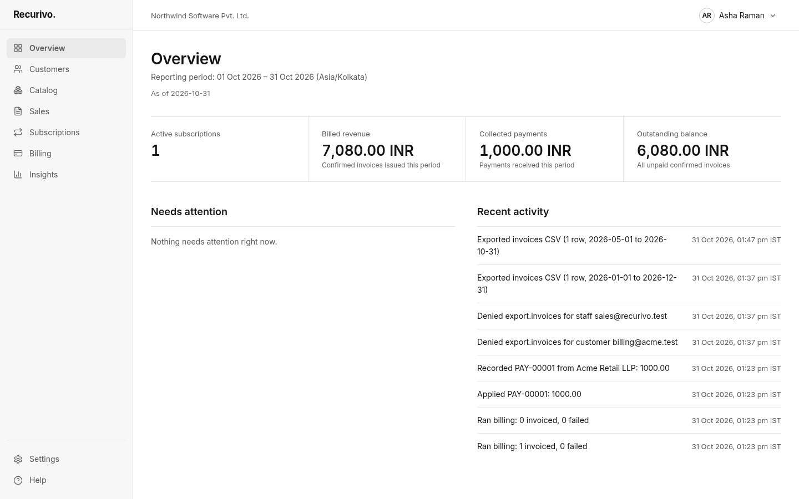
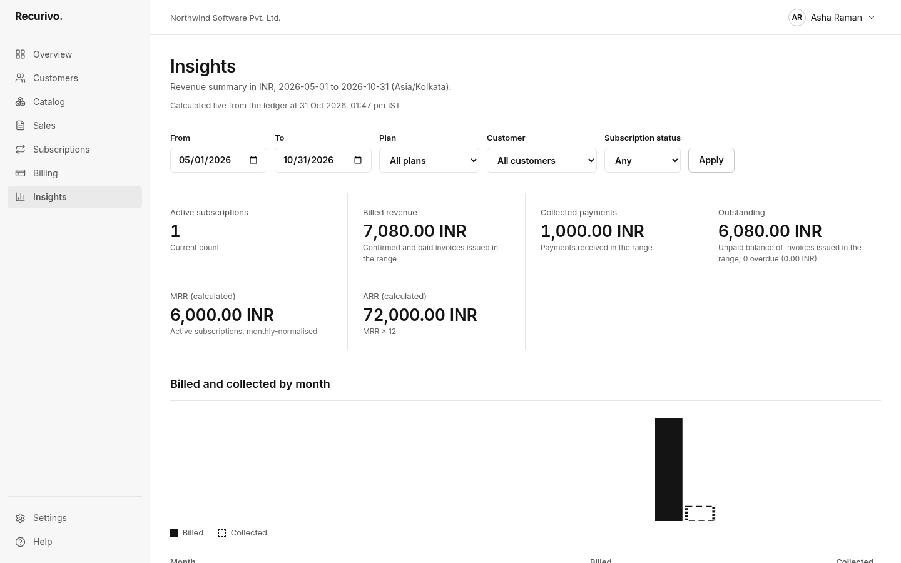
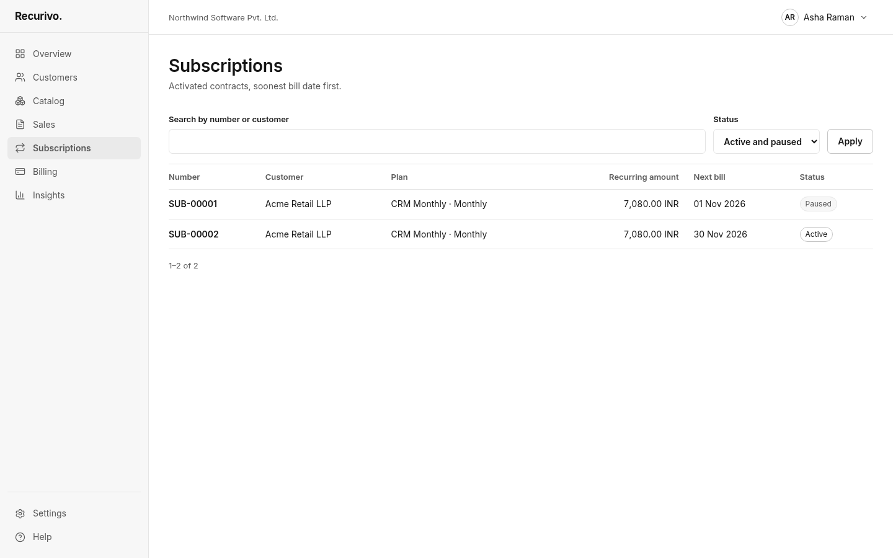
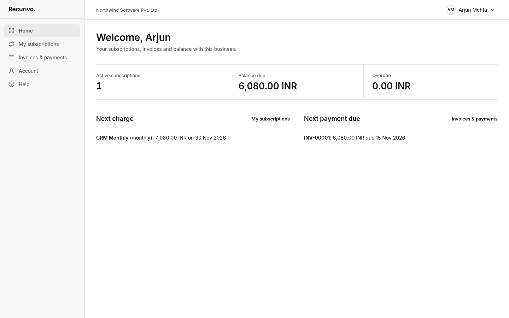

# Recurivo

Recurivo combines *Recurring* and *Vivo* (life): one traceable workflow for subscription plans, quotations, recurring invoices, payments, balances and revenue reporting.

It is a modular monolith: a Next.js (App Router, TypeScript strict) web app with a versioned REST API under `/api/v1`, PostgreSQL as the system of record (Prisma), and a separate Node worker for background jobs. No Redis is required — the worker coordinates through Postgres row locks (`FOR UPDATE SKIP LOCKED`) and a transactional outbox.

## Status

Delivered milestone by milestone, one pull request each:

| # | Milestone | State |
|---|---|---|
| 1 | Foundations: schema, design system, AppShell, auth/RBAC, outbox worker, seed, CI | done |
| 2 | Catalog & settings: products/variants, plans, taxes, discounts, staff invitations | done |
| 3 | Sales & subscriptions: customers, templates, quotations, server-side pricing, lifecycle | done |
| 4 | Billing: idempotent cycle worker, invoices, PDF/email, payments, exceptions | done |
| 5 | Customer portal, Overview, Insights, CSV export, audit log | done |
| 6 | Hardening: acceptance tests AT-01–AT-12, 10k performance profile, restore drill, accessibility checks | this branch |

See [docs/hardening.md](docs/hardening.md) for the acceptance matrix, performance results and the restore drill.

## Run locally (Windows, no Docker)

Requirements: Node.js 20.9+ (22 LTS recommended) and PostgreSQL 14+.

1. Install PostgreSQL for Windows (EDB installer) or inside WSL (`sudo apt install postgresql`), then create the database. In PowerShell:

   ```powershell
   psql -U postgres -c "CREATE USER recurivo WITH PASSWORD 'recurivo' CREATEDB;"
   psql -U postgres -c "CREATE DATABASE recurivo OWNER recurivo;"
   ```

2. Configure and install:

   ```powershell
   Copy-Item .env.example .env
   npm install
   npm run db:migrate
   npm run db:seed
   ```

3. Start the app and the worker in two terminals:

   ```powershell
   npm run dev      # http://localhost:3000
   npm run worker   # runs billing cycles every minute and delivers queued emails/invoices
   ```

Docker users can run `docker compose up -d db` instead of step 1.

### Demo accounts

All seeded accounts use the password `Recurivo#2026` (override with `SEED_PASSWORD` before seeding). Demo data only — never seed a production database.

| Email | Role |
|---|---|
| admin@recurivo.test | Administrator |
| finance@recurivo.test | Staff — finance lead profile |
| sales@recurivo.test | Staff — sales profile |
| billing@acme.test | Customer (portal) |

With `MAIL_TRANSPORT=sandbox`, emails such as password-reset links are stored in Postgres and listed at http://localhost:3000/dev/mailbox (disabled in production).

## Screenshots

| Overview | Insights |
|---|---|
|  |  |
| **Subscriptions** | **Customer portal** |
|  |  |

Regenerate with `SCREENSHOTS=1 npm run e2e -- tests/e2e/docs.spec.ts`.

### Demo walkthrough

1. Sign in as `admin@recurivo.test`. Catalog shows CRM with the Odoo +560 variant. Sales → New quotation prices it on the server.
2. Send, confirm and activate the quotation, then Billing → Run billing now issues the invoice. The PDF and email appear in `/dev/mailbox`.
3. Record a partial payment under Billing → Payments. The invoice moves to Partially paid with the balance shown.
4. Sign in as `billing@acme.test` to see the same invoice, balance and receipt in the portal.
5. Insights reconciles billed, collected and outstanding amounts, and each CSV export is recorded in Settings → Audit log.

## Scripts

| Command | Purpose |
|---|---|
| `npm run dev` / `build` / `start` | Next.js app |
| `npm run worker` | Background worker: billing cycles (`BILLING_INTERVAL_MS`, default 60s) and outbox delivery |
| `npm run lint` / `typecheck` | ESLint / `tsc --noEmit` |
| `npm test` | Unit tests (no database) |
| `npm run test:integration` | Database tests (needs `DATABASE_URL`) |
| `npm run test:all` | Unit and database tests |
| `npm run e2e` | Playwright journeys with axe accessibility checks against `npm run start` (run `npm run build` first; `CHROME_PATH` selects a local Chrome, otherwise `npx playwright install chromium`) |
| `npm run perf` | AT-11 profile: seeds 10,000 subscriptions in a separate organization and reports p50/p95/p99 |
| `scripts/restore-drill.sh` | AT-12 backup/restore drill with reconciliation (`PG_EXEC="docker exec -i recurivo-pg"` for Docker) |
| `npm run db:migrate` / `db:seed` / `db:reset` | Apply migrations / seed demo data / reset |

## Design decisions

- **Money** is `NUMERIC(18,4)` in Postgres and `decimal.js` in code, rounded half-up to the currency's minor unit. No floating point.
- **Billing dates** are calendar dates in the organization timezone. Monthly/yearly periods are always computed from the original start date with an end-of-month clamp (31 Jan → 28/29 Feb → 31 Mar).
- **No double billing**: `UNIQUE(subscriptionId, periodStart)` on billing cycles plus a partial unique index allowing one non-cancelled invoice per cycle. Integration tests run concurrent inserts against both.
- **Side effects** (emails, later webhooks) are written to an outbox table in the same transaction as the business change and delivered by the worker with retries and backoff.
- **Authorization** is enforced on the server for every page, server action and API route. The UI hides controls only for clarity. Records outside a user's scope return "not found".
- **Auth**: Argon2id password hashes; database-backed sessions in an HttpOnly, SameSite=Lax cookie (Secure in production); Postgres-backed rate limits on login, registration and reset; single-use reset tokens hashed at rest that expire after 30 minutes and revoke existing sessions; same-origin checks on cookie-authenticated API writes.
- **Password rule** (from the brief): more than eight characters with uppercase, lowercase and a special character. Minimum length is configurable per organization.

### Open assumptions (from the PRD, pending confirmation)

One organization per deployment; currency and timezone set per organization (seeded as INR / Asia/Kolkata); manual payments only; no discount stacking; paused subscriptions do not create billing cycles. MFA for administrators (AUTH-07) is not implemented yet.

## Design system

"Quiet Ledger": monochrome, Inter only (self-hosted variable font in `public/fonts`, SIL Open Font License), tabular numerals for money, hairline dividers instead of cards, one primary action per page, statuses communicated by wording and weight rather than color. Tokens live in `src/styles/tokens.css`.

## Billing

- The worker bills every active subscription whose next bill date has arrived (in the organization's time zone). Each cycle claims the subscription row with `FOR UPDATE SKIP LOCKED`; `UNIQUE(subscriptionId, periodStart)` and a partial unique index on active invoices per cycle make retries and concurrent workers safe. Missed periods are caught up on the next run.
- Invoice lines copy the subscription's agreed quantities and unit prices; taxes in effect on the period start are applied, and the subscription's discount is applied only if it is still valid and a usage slot can be claimed atomically.
- Invoices are issued as Confirmed and emailed with a PDF through the outbox. Failed sends and failed cycles appear under Billing → Exceptions.
- Payments are recorded manually and applied to open invoices (partial payments allowed). Reversals restore balances; a paid invoice must have its payments reversed before it can be cancelled.
- Admins (or staff with `billing.manage`) can trigger a run from Billing → Invoices → Run billing now.
